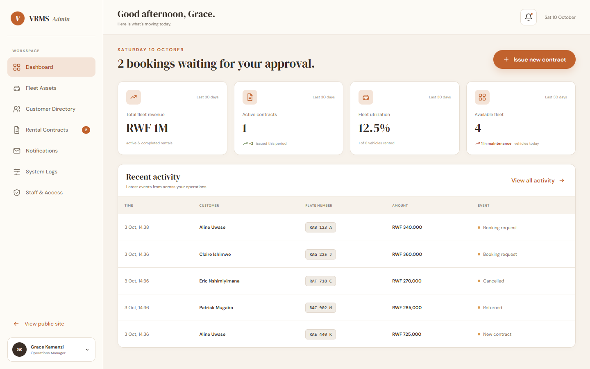

# VRMS: Vehicle Rental Management System

[](https://github.com/mbishflavien/Vehicle-Rental-Management-System/actions/workflows/ci.yml)

A full-stack web platform for a Rwandan vehicle rental agency. Customers browse the fleet and book
online; rental agents and managers run vehicles, customers and contracts from a staff console; every
booking and status change emails and texts the customer through RabbitMQ.

**MBISHIBISHI Flavien · 27857 · Web Technology (2026–2027)**



## Grading rubric → evidence

**Mid-term (30 marks)**

| # | Criterion | Marks | Evidence |
|---|---|:-:|---|
| 1 | Problem statement, target users, objectives, scope; functional/business requirements; measurable quality attributes (usability, performance, reliability, security); 2–3 user stories with acceptance criteria | 10 | [docs/01-requirements.md](docs/01-requirements.md): §1.1–1.4 problem/users/objectives/scope, §1.5 requirements BR-01…FR-14, §1.6 quality attributes with targets and measured results, §1.7 three user stories with Given/When/Then criteria |
| 2 | ER-style diagram or UML class diagram: core entities, attributes, relationships | 10 | [docs/02-data-model.md §2.1–2.2](docs/02-data-model.md): ER diagram and UML class diagram ([PNG: erd](docs/diagrams/erd.png), [uml](docs/diagrams/uml-class-diagram.png)) |
| 3 | Principal domain concepts (actors, processes, data objects), implementation-independent | 5 | [docs/02-data-model.md §2.3](docs/02-data-model.md#23-domain-concepts-implementation-independent) + [contract state machine](docs/diagrams/contract-state-machine.png) |
| 4 | Technology-oriented schema with primary keys, foreign keys, constraints, indexes | 5 | [docs/02-data-model.md §2.4](docs/02-data-model.md#24-technology-oriented-schema) and the executable [Flyway migration](src/main/resources/db/migration/V1__initial_schema.sql) (PostgreSQL), plus MongoDB collections and RabbitMQ topology |

**Final (40 marks)**

| # | Criterion | Marks | Evidence |
|---|---|:-:|---|
| 1 | Responsive web pages in a modern framework; mock-ups/wireframes showing layout across devices | 10 | React 19 + TypeScript ([`frontend/`](frontend)); [Figma design](https://www.figma.com/make/9onglo1jX7XiV8dwmBgoU3/Vehicle-Rental-Management-System); [screens at desktop 1440 / tablet 834 / phone 390 px](docs/04-ui-design.md) with the breakpoint strategy |
| 2 | Backend with an architecture style and framework, communicating with the frontend and producing outputs for users | 15 | Spring Boot 3, **layered** (controller → service → repository) + **event-driven** messaging ([docs/03-architecture.md](docs/03-architecture.md)); REST/JSON API documented live at `/swagger-ui.html`; outputs: dashboard KPIs, contracts, emails/SMS, CSV exports |
| 3 | Relational **and** non-relational databases for documents and operation data | 5 | **PostgreSQL**: users, customers, branches, vehicles, contracts. **MongoDB**: audit trail and notifications (operation data), customer licence/ID scans in **GridFS** (documents) |
| 4 | Secure authentication incl. **OAuth2**; performance optimisation; **RBAC** authorisation | 5 | OAuth2 resource server (signed JWT bearer tokens) + OAuth2 login with Google/GitHub; BCrypt, sign-in lockout, CSP. Performance: caches, entity graphs, indexes, gzip, code splitting (measured p95 < 100 ms). RBAC: Admin/Agent/Customer → 15 permissions on every endpoint ([matrix](docs/03-architecture.md#authorization-rbac)) |
| 5 | **RabbitMQ** as message broker for email, SMS and other events | 3 | Topic exchange `vrms.events` → email, SMS and staff-alert queues, retries + dead-letter queue ([§3.4](docs/03-architecture.md#34-messaging-rabbitmq)); sent messages visible in the app and in Mailpit |
| 6 | Git throughout, meaningful commits, PR to main | 2 | One commit per feature on `feat/fullstack`, [pull request #1](https://github.com/mbishflavien/Vehicle-Rental-Management-System/pull/1) |
| Bonus 1 | DevOps for deployment | + | Multi-stage **Dockerfile**, **docker compose** full stack, **GitHub Actions** CI/CD publishing the image to GHCR |
| Bonus 2 | Software testing & QA | + | **32 backend** tests (unit + integration on real PostgreSQL/MongoDB/RabbitMQ/SMTP via **Testcontainers**) + **13 frontend** tests (Vitest), all in CI ([docs/05-testing.md](docs/05-testing.md)) |
| Bonus 3 | New technology | + | Testcontainers, Flyway, GridFS, Spring Security OAuth2, Africa's Talking SMS, Mailpit, OpenAPI/Swagger, Vitest, Playwright |

## Features

**Customers:** browse and filter the fleet by branch, type and price · reserve a vehicle (held as *Pending*) · sign up with email, Google or GitHub · upload driver license/ID scans · see bookings, cancel pending ones, read every email/SMS VRMS sent them.

**Rental agents:** dashboard · register walk-in customers · issue contracts with live cost · approve bookings, record returns, cancel · put vehicles in maintenance · verify customer documents.

**Admins:** everything agents do, plus deleting records, branches, the audit log and **staff accounts & roles**.

**Business rules:** Rwandan plate format (`RAB 123 A`, stored `RAB123A`), licenses start with `DL-`, no duplicate customers, no double bookings, rentals up to 90 days, vehicle status always follows the contract (Pending→Reserved, Active→Rented, Completed/Cancelled→Available), deletes refused while a rental is open.

## Tech stack

| Layer | Technology |
|---|---|
| Frontend | React 19, TypeScript, Vite, React Router, CSS variables (Figma design tokens) |
| Backend | Java 17, Spring Boot 3.3 (Web, Security, OAuth2 Resource Server + Client, Data JPA, Data MongoDB, AMQP, Mail, Cache, Actuator), springdoc OpenAPI |
| Data | PostgreSQL 17 (Flyway migrations), MongoDB 7 (+ GridFS), Caffeine cache |
| Messaging | RabbitMQ 3.13, SMTP (Mailpit in development), Africa's Talking SMS |
| DevOps & QA | Docker, docker compose, GitHub Actions, GHCR, JUnit 5, Testcontainers, Awaitility, Vitest, Testing Library |

## Run it

### Option A: everything in Docker (recommended)

```bash
cp .env.example .env          # then set DB_PASSWORD, JWT_SECRET (openssl rand -base64 48), ADMIN_PASSWORD, AGENT_PASSWORD
docker compose up -d --build
```

### Option B: develop in IntelliJ + Vite

1. `docker compose up -d postgres mongo rabbitmq mailpit` (or use local installs).
2. Copy `src/main/resources/application-secrets.properties.example` → `application-secrets.properties` and fill it in
   (set `DB_URL=jdbc:postgresql://localhost:5433/vrms_db` if you use the compose PostgreSQL).
3. In IntelliJ set the project SDK to **Java 17** and run `VehicleRentalApplication`.
4. `cd frontend && npm install && npm run dev` → http://localhost:5173 (API calls are proxied to :8080).

### URLs

| What | URL |
|---|---|
| App | http://localhost:8080 |
| API docs (Swagger UI) | http://localhost:8080/swagger-ui.html |
| Health | http://localhost:8080/actuator/health |
| Emails sent by VRMS (Mailpit) | http://localhost:8025 |
| RabbitMQ management (guest/guest) | http://localhost:15672 |

### Accounts

| Role | Email | Password |
|---|---|---|
| Admin | `admin@vrms.rw` | `ADMIN_PASSWORD` from `.env` / secrets file |
| Agent | `agent@vrms.rw` | `AGENT_PASSWORD` |
| Customer | register on the site, or use Google/GitHub | |

Demo branches, vehicles, customers and contracts are loaded on first start.

### Optional integrations

- **Google / GitHub sign-in:** create OAuth credentials and set `GOOGLE_CLIENT_ID`/`SECRET` and/or `GITHUB_CLIENT_ID`/`SECRET`. Redirect URI: `http://localhost:8080/login/oauth2/code/{google|github}`.
- **Real SMS:** set `AT_USERNAME` and `AT_API_KEY` from [Africa's Talking](https://africastalking.com) (`sandbox` for testing). Without a key, SMS are simulated and logged.

## Tests

```bash
./mvnw test               # 32 backend tests; needs Docker running (Testcontainers)
cd frontend && npm test   # 13 frontend tests
```

## Documentation

1. [Requirements](docs/01-requirements.md): problem, users, objectives, scope, requirements, quality attributes, user stories
2. [Domain & data model](docs/02-data-model.md): ER and UML diagrams, domain concepts, PostgreSQL/MongoDB/RabbitMQ schema
3. [Architecture](docs/03-architecture.md): layers, flows, OAuth2, RBAC, messaging, performance, deployment
4. [UI design](docs/04-ui-design.md): responsive screens on desktop, tablet and phone
5. [Testing](docs/05-testing.md): strategy, inventory, results

Diagram images for reports are in [`docs/diagrams/`](docs/diagrams). Vehicle photo credits: [docs/IMAGE_CREDITS.md](docs/IMAGE_CREDITS.md).
